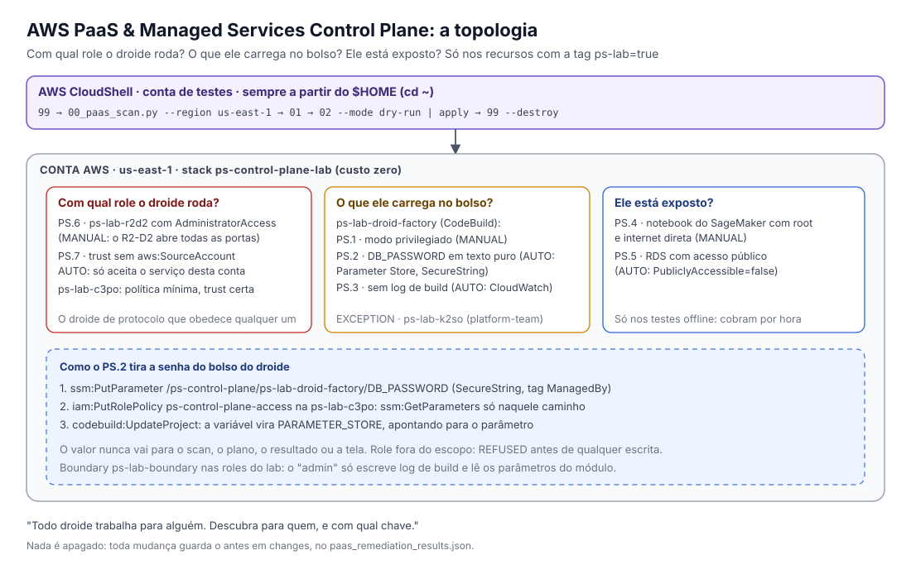

# AWS PaaS & Managed Services Control Plane

<p align="center">
  <a href="#-português">Português</a> •
  <a href="#-english">English</a>
</p>

<p align="center">
  
</p>

---

## Antes de tudo: clone (ou atualize) a série no AWS CloudShell

O AWS CloudShell é um terminal no navegador que já vem autenticado, com a AWS CLI e o Git instalados. É o jeito mais rápido de testar a série inteira.

**Clone (ou atualize) os módulos da série no `$HOME`**

```bash
cd ~
for repo in $(gh repo list wagnermazevedo -L 100 --json name -q '.[].name' | grep -E '^AWS-.*Control-Plane'); do
    if [ -d "$repo/.git" ]; then
        git -C "$repo" pull --ff-only          # já clonado: só atualiza
    else
        gh repo clone "wagnermazevedo/$repo"   # primeira vez: clona
    fi
done
```

O mesmo comando serve para a primeira vez e para atualizar depois. O `--ff-only` nunca mistura mudanças: se você alterou algum arquivo localmente, o Git avisa e não mexe naquele repositório.

(Se a GitHub CLI não estiver autenticada, rode `gh auth login` antes. Ou clone só o módulo que quiser com `git clone`.)

## Before anything: clone (or update) the series in AWS CloudShell

AWS CloudShell is a browser-based terminal that comes already authenticated, with the AWS CLI and Git installed. It is the fastest way to try the whole series.

**Clone (or update) the series modules in `$HOME`**

```bash
cd ~
for repo in $(gh repo list wagnermazevedo -L 100 --json name -q '.[].name' | grep -E '^AWS-.*Control-Plane'); do
    if [ -d "$repo/.git" ]; then
        git -C "$repo" pull --ff-only          # already cloned: just update
    else
        gh repo clone "wagnermazevedo/$repo"   # first time: clone
    fi
done
```

The same command works the first time and for later updates. `--ff-only` never mixes changes: if you changed a file locally, Git warns you and leaves that repository alone.

(If the GitHub CLI is not authenticated, run `gh auth login` first. Or clone only the module you want with `git clone`.)


---

## 🇧🇷 Português

No episódio anterior, a gente fechou a rede. Mas, lá dentro, os serviços gerenciados da AWS trabalham por você: o CodeBuild compila, o SageMaker treina, o RDS guarda. E cada um deles age **com uma role sua**.

"Estes não são os droides que você procura." Na verdade, são exatamente eles. Um projeto do CodeBuild com a senha do banco em texto puro, uma service role com AdministratorAccess "porque o pipeline não rodava", um notebook com root e internet direta, um banco com endereço público. Nenhum deles é um usuário, e por isso quase ninguém olha.

> **Todo droide trabalha para alguém. Descubra para quem, e com qual chave.**

### O que você vai aprender aqui

- Responder às **três perguntas** de PaaS: com qual role o serviço roda e se ela é maior do que precisa, o que o serviço carrega no bolso, e se ele está exposto.
- O que é **confused deputy**: um serviço da AWS que pode ser usado por outra conta para agir com a sua role, e por que `aws:SourceAccount` na trust policy resolve.
- Tirar segredo de variável de ambiente do CodeBuild e mandar para o **Parameter Store** (SecureString), sem nunca mostrar o valor.
- Por que modo privilegiado e notebook com root são decisões com dono, e não ajustes automáticos.

### A história em três perguntas

| Pergunta | O que é | Controles |
|---|---|---|
| **Com qual role o droide roda?** | Service role com admin, e trust policy que aceita o serviço vindo de qualquer conta | PS.6 (o R2-D2) e PS.7 (o droide de protocolo que obedece qualquer um) |
| **O que ele carrega no bolso?** | Build privilegiado, senha em texto puro na variável de ambiente, build sem log | PS.1, PS.2 e PS.3 (a fábrica de droides) |
| **Ele está exposto?** | Notebook com root e internet direta, banco com endereço público | PS.4 (o holocron) e PS.5 (os arquivos Jedi) |

### Os controles deste episódio

| Controle | O que verifica | Decisão | Ação / Security Hub |
|---|---|---|---|
| PS.1 | Projeto do CodeBuild em modo privilegiado | MANUAL | Runbook: exceção com dono para quem constrói imagem, ou builder sem daemon / CodeBuild.5 |
| PS.2 | Variável PLAINTEXT com cara de segredo (pelo nome, ou valor com cara de access key) | AUTO | Grava o valor como SecureString em `/ps-control-plane/<projeto>/<VARIAVEL>`, dá `ssm:GetParameters` só nesse caminho à service role e troca a variável para `PARAMETER_STORE` / CodeBuild.2 |
| PS.3 | Projeto do CodeBuild sem log de build (CloudWatch e S3 desligados) | AUTO | Cria `/aws/codebuild/<projeto>` com retenção, dá permissão de escrita à role e liga o log / CodeBuild.4 |
| PS.4 | Notebook do SageMaker com root ou internet direta | MANUAL | Runbook: exige parar o notebook e, para a internet, uma VPC / SageMaker.1 e SageMaker.3 |
| PS.5 | Banco do RDS com acesso público | AUTO | `PubliclyAccessible=false`, aplicado na hora / RDS.2 |
| PS.6 | Service role com `AdministratorAccess` ou Allow `*` em `*` | MANUAL | Runbook: política mínima a partir do último acesso por serviço |
| PS.7 | Trust policy que deixa um serviço assumir a role sem `aws:SourceAccount` ou `aws:SourceArn` | AUTO | Acrescenta `aws:SourceAccount = <esta conta>` (a trust anterior fica em `changes`) |

**Por que PS.1, PS.4 e PS.6 são MANUAL?** Desligar o modo privilegiado quebra quem constrói imagem Docker. Mudar root ou internet do notebook exige pará-lo. E tirar o admin de uma service role pode parar o pipeline inteiro. O módulo mostra, com o motivo, e você decide com o dono.

**Confused deputy em uma frase.** Quando a trust policy diz só "o CodeBuild pode assumir", ela não diz o CodeBuild **de quem**. Com `aws:SourceAccount` igual à sua conta, só um projeto seu consegue usar a role. Para serviços como EC2 e Lambda, que não agem em nome de outras contas, o PS.7 fica `NOT_APPLICABLE` (a lista está em `config/controls/PS.7.yaml`).

### Como funciona: scan, plan e remediate

1. **Scan, que só olha.** Lista projetos do CodeBuild, notebooks do SageMaker, bancos do RDS e as service roles (roles cuja trust policy tem `Principal.Service`), separa os do escopo e avalia cada controle. **Nenhum valor de variável de ambiente sai da conta:** o scan grava só o nome.
2. **Plan, que só decide.** Cruza cada item com o `config/paas_map.yaml` e os arquivos de `config/controls/`: `AUTO`, `MANUAL`, `EXCEPTION` ou `NO_ACTION`, com o preview do antes e do depois.
3. **Remediate, que age com cuidado.** Dry-run por padrão. No apply, lê cada recurso ao vivo de novo, confere escopo e exceção, corrige e confere outra vez (`VERIFIED`).

> **A regra de ouro:** nada é apagado. O módulo nunca apaga projeto, notebook, banco ou role. Toda mudança guarda o antes em `changes`.

**As travas de segurança do próprio módulo:**
- **Escopo por tag.** Por padrão, só recursos com `ps-lab=true`. A service role entra pelas tags **dela**: um projeto do lab que usa uma role de fora do escopo não dá ao módulo o direito de mexer nessa role, e o PS.2 e o PS.3 viram `REFUSED` antes de alterar qualquer coisa.
- **Exceção com dono.** `ps-exception` (o motivo) e `exception-owner` (o responsável) viram `EXCEPTION`. Sem dono, `MANUAL`.
- **Tags conferidas ao vivo** entre o plan e o apply. Mudou? `REFUSED`.
- **Segredo nunca na tela.** Nem no scan, nem no plano, nem no resultado do apply: só o nome da variável e do parâmetro.
- **Parâmetro com dono.** Se `/ps-control-plane/<projeto>/<VARIAVEL>` já existir sem a tag `ManagedBy=aws-paas-managed-services-control-plane`, o PS.2 recusa.
- **Permissão mínima.** O que o módulo dá à service role fica numa política inline só dele (`ps-control-plane-access`), um statement por projeto e por motivo, restrito ao caminho do parâmetro ou ao grupo de log.
- **Roles do Control Tower, Organizations e StackSets** são só reportadas, nunca alteradas. Service-linked roles nem entram no inventário.

### Mão na massa no AWS CloudShell

Todos os comandos rodam a partir do seu `$HOME`, numa **conta de testes**, em `us-east-1`.

**1. Clone e instale**

```bash
cd ~
git clone https://github.com/wagnermazevedo/AWS-PaaS-Managed-Services-Control-Plane.git
pip3 install --user -r ~/AWS-PaaS-Managed-Services-Control-Plane/requirements.txt
```

**2. Monte o laboratório**

```bash
cd ~
python3 ~/AWS-PaaS-Managed-Services-Control-Plane/scripts/99_paas_lab_setup.py --region us-east-1
```

Digite `LAB` para confirmar. O 99 sobe a stack `ps-control-plane-lab` (`lab_insecure/paas-lab.yaml`), com tudo marcado com `ps-lab=true`:

| Recurso | O problema | Controle |
|---|---|---|
| Projeto `ps-lab-droid-factory` | Modo privilegiado, `DB_PASSWORD` em texto puro e sem log de build | PS.1, PS.2 e PS.3 |
| Projeto `ps-lab-bb8` | Nenhum: é o droide que faz tudo certo | — |
| Projeto `ps-lab-k2so` | Privilegiado, com `ps-exception` e `exception-owner=platform-team` (constrói imagem Docker) | EXCEPTION |
| Role `ps-lab-r2d2` | Service role do CodeBuild com `AdministratorAccess` e trust sem `aws:SourceAccount` | PS.6 e PS.7 |
| Role `ps-lab-c3po` | Nenhum: política mínima e trust com `aws:SourceAccount`. É a role dos projetos | — |

Para o lab não virar risco de verdade, as duas roles nascem com o boundary `ps-lab-boundary`, o "restraining bolt" do lab: mesmo com AdministratorAccess na política (é o que o PS.6 enxerga), elas só conseguem escrever log de build e ler os parâmetros do módulo. A senha do lab é falsa (`lab-not-a-real-password`).

Ficam de fora do lab, e são cobertos só pelos testes offline: o **PS.4** e o **PS.5**, porque notebook do SageMaker e RDS cobram por hora. Para só ver o estado, `--list`.

**3. Scan, plan e remediate**

```bash
cd ~
python3 ~/AWS-PaaS-Managed-Services-Control-Plane/scripts/00_paas_scan.py --region us-east-1
python3 ~/AWS-PaaS-Managed-Services-Control-Plane/scripts/01_paas_plan.py
python3 ~/AWS-PaaS-Managed-Services-Control-Plane/scripts/02_paas_remediate.py --region us-east-1 --mode dry-run
python3 ~/AWS-PaaS-Managed-Services-Control-Plane/scripts/02_paas_remediate.py --region us-east-1 --mode apply
```

No apply: a `DB_PASSWORD` da fábrica de droides vai para o Parameter Store e a variável passa a apontar para ele, o log de build liga no grupo `/aws/codebuild/ps-lab-droid-factory`, a `ps-lab-c3po` ganha só a permissão para ler aquele parâmetro e escrever naquele grupo, e a trust do R2-D2 passa a exigir `aws:SourceAccount`. Tudo `VERIFIED`. O modo privilegiado e o admin do R2-D2 ficam para o dono.

**4. Confira no console**

CodeBuild → `ps-lab-droid-factory` → **Edit** → **Environment**: a `DB_PASSWORD` agora é do tipo **Parameter**. E no Systems Manager → **Parameter Store**, o `/ps-control-plane/ps-lab-droid-factory/DB_PASSWORD` como SecureString. Não clique em **Show** durante a gravação.

**5. A evidência e o desmonte**

```bash
cd ~
cat "$(ls -td ~/AWS-PaaS-Managed-Services-Control-Plane/outputs/2*/ | head -1)summary.md"
python3 ~/AWS-PaaS-Managed-Services-Control-Plane/scripts/99_paas_lab_setup.py --region us-east-1 --destroy
```

O `--destroy` tira a política inline do módulo das roles do lab (antes da stack, senão o CloudFormation não consegue apagar a role), apaga a stack, e apaga os parâmetros `/ps-control-plane/…` e os grupos `/aws/codebuild/ps-lab-…` que o remediate criou, só os com a tag `ManagedBy`.

### Rodando com o orquestrador do template

```bash
cd ~
bash ~/AWS-PaaS-Managed-Services-Control-Plane/test-control-plane.sh AWS-PaaS-Managed-Services-Control-Plane
```

### Quer adicionar um controle novo?

1. **Declare o controle** em `config/controls/PS.N.yaml` (`id`, `title`, `decision`, e `action`/`params` se for AUTO). Só com o arquivo, o scan já avisa `ERROR NO_CHECK`.
2. **Ensine o scanner:** um `check_...` em `scanner/checks.py`, registrado em `CHECKS` com o tipo (`codebuild`, `notebook`, `rds` ou `servicerole`), e uma linha em `EXPECTED`. Serviço novo? `list_` e `load_` em `scanner/inventory.py` e o nome no `SERVICES` do `lib/aws.py`.
3. **Escreva a correção** em `remediate/<acao>.py` (respeitando o dry-run) e registre no `REGISTRY`. Precisa dar permissão à service role? Use o `remediate/_role_access.py`.
4. **Laboratório:** o recurso com o problema e a tag `ps-lab` no `lab_insecure/paas-lab.yaml`. Se cobrar por hora, deixe só nos testes.
5. **Testes:** o cenário no `tests/fakes.py` e um teste no `tests/test_control_plane.py`.

### O que fica salvo em cada execução

Cada execução cria uma pasta nova em `outputs/` (YAML para o plan, JSON como fonte da verdade, CSV para o Athena e `summary.md`). O plano fica em `outputs/remediation_plan.yaml`, e o remediate grava `paas_remediation_results.json`, `.csv` e `summary.md`, com o antes de cada mudança em `changes`.

### Gravando ou compartilhando a tela? Modo gravação

Ligado por padrão. No terminal, no `summary.md` e nos CSVs, o número da conta, ARNs e nomes fora do laboratório viram apelidos estáveis. Os nomes do laboratório (`ps-lab-…` e `ps-control-plane…`) continuam legíveis. YAML e JSON ficam com os valores reais: não abra na gravação. Para desligar, `--no-mask` ou `SCP_MASK=0`. Nunca faça commit de `outputs/.mask-key`.

### Permissões necessárias

- **Scan:** `codebuild:ListProjects`, `codebuild:BatchGetProjects`, `sagemaker:ListNotebookInstances`, `sagemaker:DescribeNotebookInstance`, `sagemaker:ListTags`, `rds:DescribeDBInstances`, `iam:ListRoles`, `iam:GetRole`, `iam:ListRoleTags`, `iam:ListAttachedRolePolicies`, `iam:ListRolePolicies`, `iam:GetRolePolicy`, `iam:GetPolicy`, `iam:GetPolicyVersion` e `sts:GetCallerIdentity`.
- **Apply:** `codebuild:UpdateProject`, `ssm:PutParameter`, `ssm:AddTagsToResource`, `ssm:ListTagsForResource`, `logs:CreateLogGroup`, `logs:TagResource`, `logs:PutRetentionPolicy`, `iam:PutRolePolicy`, `iam:UpdateAssumeRolePolicy` e `rds:ModifyDBInstance`.
- **Laboratório:** `cloudformation:*` na stack do lab, a criação e a exclusão dos recursos dela (roles, policy e projetos), `iam:DeleteRolePolicy`, `ssm:GetParametersByPath`, `ssm:DeleteParameters`, `logs:DescribeLogGroups`, `logs:ListTagsForResource` e `logs:DeleteLogGroup`.

### Quanto custa

- **Laboratório:** zero. Projeto do CodeBuild parado, role e policy do IAM não cobram.
- **Parameter Store:** parâmetro Standard é gratuito; a SecureString usa a chave `aws/ssm`, sem custo de chave.
- **CloudWatch Logs:** só se um build rodar (o lab nunca roda). Retenção de 90 dias por padrão.
- **SageMaker e RDS:** o módulo só lê. Se você criar um notebook ou um banco para testar o PS.4 e o PS.5, eles cobram por hora: apague no mesmo dia.

### Testes

```bash
cd ~
python3 -m unittest discover -s ~/AWS-PaaS-Managed-Services-Control-Plane/tests -v
```

Os testes rodam numa conta simulada, sem AWS, validando cada chamada contra o modelo oficial do botocore. Eles cobrem o scan sem escrita, a produção e as roles da AWS fora do escopo, as decisões do plano, o dry-run sem escrita, o apply com rescan em PASS e segunda rodada sem nada a fazer, **o valor do segredo que nunca aparece em nenhum arquivo nem na tela**, a role de fora do escopo nunca alterada, o parâmetro de outro dono, a access key com nome inocente, as roles do Control Tower só reportadas, a tag tirada depois do plano, o plano de outra conta, a lista de serviços do PS.7, o setup, o `--list` e o `--destroy` do laboratório e o modo gravação. O PS.4 (o holocron) e o PS.5 (os arquivos Jedi) só existem aqui.

### Onde fica cada coisa

```text
AWS-PaaS-Managed-Services-Control-Plane/
├── test-control-plane.sh               # Orquestrador de testes do template
├── scripts/
│   ├── 00_paas_scan.py                 # Olha
│   ├── 01_paas_plan.py                 # Decide
│   ├── 02_paas_remediate.py            # Age
│   └── 99_paas_lab_setup.py            # Monta, lista (--list) e desmonta o laboratório
├── config/
│   ├── paas_map.yaml                   # O cérebro: escopo, exceções e include
│   └── controls/PS.1.yaml … PS.7.yaml  # Um arquivo por controle
├── scanner/                            # inventory.py (só leitura) e checks.py (PS.1 a PS.7)
├── remediate/                          # engine.py, _role_access.py e uma correção pequena por ação
├── lab_insecure/paas-lab.yaml          # CloudFormation da fábrica de droides
├── lib/                                # Clientes AWS, saídas, escopo, leitor do mapa e mask.py
├── tests/                              # Testes offline
├── outputs/                            # Saídas de cada execução
└── docs/                               # Arquitetura, controles, topologia e o desafio PS.8
```

### Desafio da semana

Escreva o **PS.8: função Lambda com URL pública sem autenticação** (`AuthType: NONE`), o droide com a porta de serviço aberta para a galáxia. O passo a passo está em [docs/desafio-ps8.md](docs/desafio-ps8.md). Mande um pull request, e no final, `--destroy`.

### Próximo episódio

Tudo isso acontece em nome de alguém. Mas quem anota o que aconteceu? No episódio 9, **Logging & Detection as Control Plane**: CloudTrail, GuardDuty e os registros de que todo o resto depende.

---

## 🇺🇸 English

In the previous episode we closed the network. But inside it, AWS managed services work for you: CodeBuild builds, SageMaker trains, RDS stores. And each of them acts **with one of your roles**.

"These aren't the droids you're looking for." Actually, they are.

> **Every droid works for someone. Find out who, and with which key.**

### Controls

| Control | What it checks | Decision | Action / Security Hub |
|---|---|---|---|
| PS.1 | CodeBuild project in privileged mode | MANUAL | Runbook / CodeBuild.5 |
| PS.2 | PLAINTEXT environment variable that looks like a secret (by name, or an access-key-shaped value) | AUTO | Stores it as a SecureString under `/ps-control-plane/<project>/<VAR>`, grants the service role `ssm:GetParameters` on that path only, switches the variable to `PARAMETER_STORE` / CodeBuild.2 |
| PS.3 | CodeBuild project without build logs | AUTO | Creates `/aws/codebuild/<project>` with retention, grants write access, enables logs / CodeBuild.4 |
| PS.4 | SageMaker notebook with root or direct internet access | MANUAL | Runbook / SageMaker.1, SageMaker.3 |
| PS.5 | Publicly accessible RDS instance | AUTO | `PubliclyAccessible=false`, applied immediately / RDS.2 |
| PS.6 | Service role with `AdministratorAccess` or Allow `*` on `*` | MANUAL | Runbook |
| PS.7 | Trust policy letting a service assume the role without `aws:SourceAccount` / `aws:SourceArn` (confused deputy) | AUTO | Adds `aws:SourceAccount = <this account>` |

### Safety rails

Tag-based scope (`ps-lab=true`; a service role is judged by its own tags, so a lab project using an out-of-scope role gets `REFUSED`), exceptions with an owner, live re-check of tags, **secret values never leave the account** (only variable and parameter names are written anywhere), parameters reused only when they carry the `ManagedBy` tag, least-privilege grants in a module-only inline policy, and Control Tower / Organizations / StackSets roles are report-only. **Nothing is ever deleted;** every change records its previous state.

### Quick start (AWS CloudShell, test account)

```bash
cd ~
git clone https://github.com/wagnermazevedo/AWS-PaaS-Managed-Services-Control-Plane.git
pip3 install --user -r ~/AWS-PaaS-Managed-Services-Control-Plane/requirements.txt
python3 ~/AWS-PaaS-Managed-Services-Control-Plane/scripts/99_paas_lab_setup.py --region us-east-1
python3 ~/AWS-PaaS-Managed-Services-Control-Plane/scripts/00_paas_scan.py --region us-east-1
python3 ~/AWS-PaaS-Managed-Services-Control-Plane/scripts/01_paas_plan.py
python3 ~/AWS-PaaS-Managed-Services-Control-Plane/scripts/02_paas_remediate.py --region us-east-1 --mode dry-run
python3 ~/AWS-PaaS-Managed-Services-Control-Plane/scripts/02_paas_remediate.py --region us-east-1 --mode apply
python3 ~/AWS-PaaS-Managed-Services-Control-Plane/scripts/99_paas_lab_setup.py --region us-east-1 --destroy
```

The lab is free (idle CodeBuild projects and IAM roles). PS.4 and PS.5 are covered by the offline tests only, since notebooks and databases bill by the hour. Recording mode is on by default (`--no-mask` or `SCP_MASK=0` to turn it off). Tests: `python3 -m unittest discover -s ~/AWS-PaaS-Managed-Services-Control-Plane/tests -v`.

### Weekly challenge

Write **PS.8: Lambda function URL with `AuthType: NONE`**. See [docs/desafio-ps8.md](docs/desafio-ps8.md).
